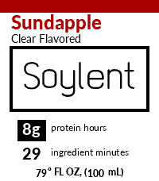
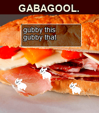
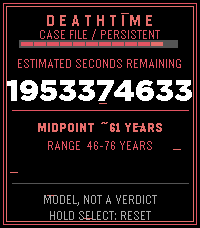

<!-- Generated by scripts/update_app_directory.py: do not edit by hand -->
[← All Pebble Developers](../developers.md)

# h3nry

*1 watchface and 4 apps · Last updated 2026-10-12 · [About these lists](../about-app-lists.md)*

Links: [Pebble App Store](https://apps.repebble.com/apps/dev/h3nry_66430b30a243d294bd0df8c0) · [GitHub (HenryTheAddict)](https://github.com/HenryTheAddict) · [Website (soylent.com)](https://soylent.com/pages/soylent-product-recommendation-quiz)

<button type="button" data-filter="all" aria-pressed="true">All 5</button><button type="button" data-filter="watchface" aria-pressed="false">Watchfaces 1</button><button type="button" data-filter="watchapp" aria-pressed="false">Apps 4</button>

<label class="dev-sort">Sort by <select><option value="updated">Recently updated</option><option value="released">Newest release</option><option value="title">A–Z</option></select></label>

<h2 class="app-name" id="app-6048f84819ea461bbf0dace0"><a href="https://apps.repebble.com/6048f84819ea461bbf0dace0">Soyface</a> v1.0.1</h2>
<a class="app-source" href="https://github.com/HenryTheAddict/soyface" title="Source code" data-search-exclude>View source</a>

Watchface

Other Released 2026-08-31 Updated 2026-08-31

Runs on: Round 2, Time 2, Time Round, Time

Soylent Bottle Inspired Watchface. Me and my friend (burger ten thousand) were joking about this as an idea, i&#x27;m not going to say what but it sounded funny in my head to make one, plus this is my…

<h2 class="app-name" id="app-17059a2b6e774b40a7254b83"><a href="https://apps.repebble.com/17059a2b6e774b40a7254b83">Gabagool.</a> v1.1.4</h2>
<a class="app-source" href="https://github.com/HenryTheAddict/GabagoolPebble" title="Source code" data-search-exclude>View source</a>

App

No licence Released 2026-07-04 Updated 2026-07-16

Runs on: Round 2, Time 2

Gabagool. featuring. the plexer JP as seen on CloudPebble (sorry guys)

<h2 class="app-name" id="app-439b381033be483a8fc032dd"><a href="https://apps.repebble.com/439b381033be483a8fc032dd">deathtime</a> v1.0.0</h2>
<a class="app-source" href="https://github.com/HenryTheAddict/deathtime" title="Source code" data-search-exclude>View source</a>

App

No licence Released 2026-06-23 Updated 2026-06-23

Runs on: Round 2, Time 2, Pebble 2 Duo, Pebble 2, Time Round, Time, Classic

Unlike the pebble, we might not be reborn??? 😟 Uses the same principles as Vsause&#x27;s death clock except instead of 80 dollars, it&#x27;s free. made by a afraid agnostic. (of course its not to be…

<h2 class="app-name" id="app-d786a982571341658836baf2"><a href="https://apps.repebble.com/d786a982571341658836baf2">UnlockThePlock</a> v1.0</h2>
<a class="app-source" href="https://github.com/HenryTheAddict/unlockploc" title="Source code" data-search-exclude>View source</a>

App

No licence Released 2026-04-19 Updated 2026-04-19

Runs on: Round 2, Time 2, Pebble 2 Duo, Pebble 2, Time Round, Time, Classic

A clone of the game &quot;Pop The Lock&quot; For pebbles, this time it&#x27;s kinda more space themed.

<h2 class="app-name" id="app-dc217d9f68044c209c3b7f2f"><a href="https://apps.repebble.com/dc217d9f68044c209c3b7f2f">Migi&#x27;s Basics</a> v1.0</h2>
<a class="app-source" href="https://github.com/HenryTheAddict/MigiBasics" title="Source code" data-search-exclude>View source</a>

App

No licence Released 2026-04-04 Updated 2026-04-04

Runs on: Round 2, Time 2

Imagine baldi&#x27;s basics (the game) but instead of baldi, it was eric migi, and you have to run around the pebble warehouse and steal pebbles, oh yeah and there is a map... there is story mode…

