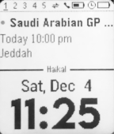

<!-- Generated by scripts/update_app_directory.py: do not edit by hand -->
[← All Pebble Developers](../developers.md)

# Haikal Fouzi

*1 watchface · Last updated 2026-10-11 · [About these lists](../about-app-lists.md)*

Links: [Rebble App Store](https://apps.rebble.io/en_US/developer/5dd7dbf5651caf0001add4f6/1) · [GitHub (haikalfouzi)](https://github.com/haikalfouzi) · [Website (twitter.com)](https://twitter.com/trndbtd)

<h2 class="app-name" id="app-61ab915a535326000935a5c3"><a href="https://apps.rebble.io/en_US/application/61ab915a535326000935a5c3">Diary Face 3.0</a> v2.8</h2>
<a class="app-source" href="https://github.com/haikalfouzi/diaryface20" title="Source code" data-search-exclude>View source</a>

Watchface

Released 2021-12-04 Updated 2021-12-04 Rebble App Store

Runs on: Time 2, Pebble 2 Duo, Pebble 2, Time, Classic

Interactive watchface for busy people! - Animated calendar cycles up to 5 recent event. - Switch between 12 or 24 hour mode. - Battery saving feature: 5s interval for the calendar animation when…

