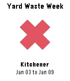

<!-- Generated by scripts/update_app_directory.py: do not edit by hand -->
[← All Pebble Developers](../developers.md)

# Halogray

*1 app · Last updated 2026-10-11 · [About these lists](../about-app-lists.md)*

Links: [Pebble App Store](https://apps.repebble.com/apps/dev/halogray_550dfba660dc26d635000079) · [GitHub (s0j)](https://github.com/s0j) · [Website (halogray.com)](https://halogray.com)

<h2 class="app-name" id="app-55711f9ce1777eac3c000072"><a href="https://apps.repebble.com/55711f9ce1777eac3c000072">Yard Waste Week</a> v1.5</h2>
<a class="app-source" href="https://github.com/s0j/yardwasteweek" title="Source code" data-search-exclude>View source</a>

App

Released 2015-06-05 Updated 2016-03-12

Runs on: Time 2, Pebble 2 Duo, Pebble 2, Time, Classic

Yard Waste Week is a simple application that quickly informs you if &quot;this week&quot; is yard waste week. Using the Yard Waste Schedule published by the Region of Waterloo, you have the option to select…

