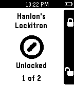

<!-- Generated by scripts/update_app_directory.py: do not edit by hand -->
[← All Pebble Developers](../developers.md)

# Hanlon

*1 app · Last updated 2026-10-11 · [About these lists](../about-app-lists.md)*

Links: [Pebble App Store](https://apps.repebble.com/apps/dev/hanlon_52b87d409efe580877000036) · [GitHub (soothslayer)](https://github.com/soothslayer)

<h2 class="app-name" id="app-53a9a197990481964a000245"><a href="https://apps.repebble.com/53a9a197990481964a000245">PebbleLock</a> v2.0</h2>
<a class="app-source" href="https://github.com/soothslayer/PebbleLock" title="Source code" data-search-exclude>View source</a>

App

Released 2014-06-24 Updated 2014-10-26

Runs on: Time 2, Pebble 2 Duo, Pebble 2, Time, Classic

Use your Pebble to lock/unlock your Lockitron door lock. (After downloading be sure to go to Settings for PebbleLock within the Pebble app and log into Lockitron.com).

