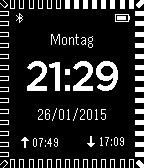

<!-- Generated by scripts/update_app_directory.py: do not edit by hand -->
[← All Pebble Developers](../developers.md)

# Hannes Hofer

*1 watchface · Last updated 2026-10-11 · [About these lists](../about-app-lists.md)*

Links: [Pebble App Store](https://apps.repebble.com/apps/dev/hannes-hofer_542e9541d4d52caaac0000f7) · [GitHub (HannesHofer)](https://github.com/HannesHofer)

<h2 class="app-name" id="app-54c6abf9ead20ff601000046"><a href="https://apps.repebble.com/54c6abf9ead20ff601000046">Aurora Watchface</a> v4.0</h2>
<a class="app-source" href="https://github.com/HannesHofer/Pebble" title="Source code" data-search-exclude>View source</a>

Watchface

BSD-2-Clause Released 2015-01-26 Updated 2015-02-12

Runs on: Time 2, Pebble 2 Duo, Pebble 2, Time, Classic

This watchface shows bluetooth icon when your phone is connected. Also current battery level is shown. Both bluetooth and battery can be disabled in the settings menu. It is possible to configure…

