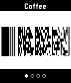

<!-- Generated by scripts/update_app_directory.py: do not edit by hand -->
[← All Pebble Developers](../developers.md)

# Harley Watson

*1 app · Last updated 2026-10-11 · [About these lists](../about-app-lists.md)*

Links: [Pebble App Store](https://apps.repebble.com/apps/dev/harley-watson_52b1e71c6ba927524b00000f) · [GitHub (unlobito)](https://github.com/unlobito)

<h2 class="app-name" id="app-553aaf29bf1a5965020000c8"><a href="https://apps.repebble.com/553aaf29bf1a5965020000c8">skunk</a> v1.9</h2>
<a class="app-source" href="https://github.com/unlobito/skunk" title="Source code" data-search-exclude>View source</a>

App · <a href="https://forum.rebble.io/t/927" title="Discuss this app on the Rebble forum" data-search-exclude>Forum thread</a>

Released 2015-04-24 Updated 2026-04-29

Runs on: Round 2, Time 2, Pebble 2 Duo, Pebble 2, Time Round, Time, Classic

Skunk allows easy access to up to eight store cards and other barcodes. Linear Barcodes: Codabar, Code 39, Code 128, EAN-8, EAN-13, Interleaved 2 of 5 (ITF), UPC-A Matrix Barcodes: Aztec, Data…

