<!-- Generated by scripts/update_app_directory.py: do not edit by hand -->
[← All Pebble Developers](../developers.md)

# Harrison Allen

*18 watchfaces and 4 apps · Last updated 2026-10-11 · [About these lists](../about-app-lists.md)*

Links: [Pebble App Store](https://apps.repebble.com/apps/dev/harrison-allen_5e28ea923dd3109f151c7e08) · [Rebble App Store](https://apps.rebble.io/en_US/developer/5e28ea923dd3109f151c7e08/1) · [GitHub (HarrisonAllen)](https://github.com/HarrisonAllen)

<button type="button" data-filter="all" aria-pressed="true">All 22</button><button type="button" data-filter="watchface" aria-pressed="false">Watchfaces 18</button><button type="button" data-filter="watchapp" aria-pressed="false">Apps 4</button>

<label class="dev-sort">Sort by <select><option value="updated">Recently updated</option><option value="released">Newest release</option><option value="title">A–Z</option></select></label>

<h2 class="app-name" id="app-6485ede3143b6504957bcfd5"><a href="https://apps.repebble.com/6485ede3143b6504957bcfd5">Tears of the Kingdom</a> v2.4.0</h2>
<a class="app-source" href="https://github.com/HarrisonAllen/totk-watchface" title="Source code" data-search-exclude>View source</a>

Watchface · <a href="https://forum.rebble.io/t/423" title="Discuss this app on the Rebble forum" data-search-exclude>Forum thread</a>

No licence Released 2023-06-11 Updated 2026-10-09

Runs on: Round 2, Time 2, Pebble 2 Duo, Pebble 2, Time Round, Time, Classic

Enjoy this Legend of Zelda: Tears of the Kingdom inspired watchface! Includes current weather and is compatible with all Pebbles!

<h2 class="app-name" id="app-6a89368b6a9b270009227f6b"><a href="https://apps.repebble.com/6a89368b6a9b270009227f6b">BombleMan Demo</a> v1.1.0</h2>
<a class="app-source" href="https://github.com/HarrisonAllen/bombleman" title="Source code" data-search-exclude>View source</a>

App · <a href="https://forum.rebble.io/t/1265" title="Discuss this app on the Rebble forum" data-search-exclude>Forum thread</a>

No licence Released 2026-08-22 Updated 2026-08-23

Runs on: Round 2, Time 2, Pebble 2 Duo, Pebble 2, Time Round, Time

BombleMan is a Bomberman clone for (most) Pebbles! Face off against 3 CPUs across 3 levels to become the ultimate &quot;Bombler&quot;! To play: * Select to move * Up/Down to turn * Back to place a bomb *…

<a class="app-shot" href="https://apps.repebble.com/60ec78db1342ae0152f9a409" data-search-exclude>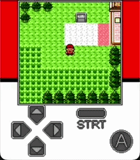</a>

<h2 class="app-name" id="app-60ec78db1342ae0152f9a409"><a href="https://apps.repebble.com/60ec78db1342ae0152f9a409">Pebblemon</a> v2.1.2</h2>
<a class="app-source" href="https://github.com/HarrisonAllen/pebble-gbc-graphics-demo" title="Source code" data-search-exclude>View source</a>

App · <a href="https://forum.rebble.io/t/493" title="Discuss this app on the Rebble forum" data-search-exclude>Forum thread</a>

MIT Released 2021-07-12 Updated 2026-06-18

Runs on: Round 2, Time 2, Pebble 2 Duo, Pebble 2, Time Round, Time

Pebblemon! A mini Pokemon adventure on your wrist. Explore various areas within the Johto region. Encounter all 251 Pokemon from the Game Boy Color games. Level up and unlock 22 different sprites!…

<a class="app-shot" href="https://apps.repebble.com/82b2092b5bbd4cc89f5642d0" data-search-exclude>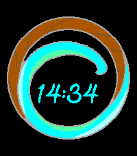</a>

<h2 class="app-name" id="app-82b2092b5bbd4cc89f5642d0"><a href="https://apps.repebble.com/82b2092b5bbd4cc89f5642d0">Kona Wave</a> v1.0</h2>
<a class="app-source" href="https://github.com/HarrisonAllen/kona-wave-watchface" title="Source code" data-search-exclude>View source</a>

Watchface · <a href="https://forum.rebble.io/t/826" title="Discuss this app on the Rebble forum" data-search-exclude>Forum thread</a>

No licence Released 2026-04-04 Updated 2026-04-04

Runs on: Round 2, Time 2, Pebble 2 Duo, Pebble 2, Time Round, Time, Classic

A watchface to match some of my real-world accessories!

<h2 class="app-name" id="app-5e28ea933dd3109f151c7e0a"><a href="https://apps.repebble.com/5e28ea933dd3109f151c7e0a">Sheikah Slate - BoTW</a> v2.4</h2>
<a class="app-source" href="https://github.com/HarrisonAllen/SheikahSlate_PebbleWatchface" title="Source code" data-search-exclude>View source</a>

Watchface · <a href="https://forum.rebble.io/t/388" title="Discuss this app on the Rebble forum" data-search-exclude>Forum thread</a>

No licence Released 2020-01-23 Updated 2026-01-04

Runs on: Round 2, Time 2, Pebble 2 Duo, Pebble 2, Time Round, Time, Classic

Put the power of the Sheikah on your wrist! Based on the Sheikah Slate from the Legend of Zelda: Breath of the Wild, this watchface features: -Time and Date Display --Supports both 12 and 24 hour…

<a class="app-shot" href="https://apps.repebble.com/68faf1b725e7530009b78af2" data-search-exclude>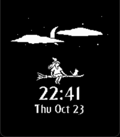</a>

<h2 class="app-name" id="app-68faf1b725e7530009b78af2"><a href="https://apps.repebble.com/68faf1b725e7530009b78af2">Witching Hour</a> v1.7</h2>
<a class="app-source" href="https://github.com/HarrisonAllen/witching-hour" title="Source code" data-search-exclude>View source</a>

Watchface

No licence Released 2025-10-24 Updated 2025-10-28

Runs on: Round 2, Time 2, Pebble 2 Duo, Pebble 2, Time Round, Time, Classic

A cozy animated, live weather watchface for the Halloween season. Features: * Live weather via Open Meteo (witch changes outfits + accessories (customizable), clouds/weather conditions appear) *…

<a class="app-shot" href="https://apps.repebble.com/6829ee069844c10008ad576c" data-search-exclude>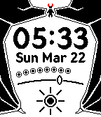</a>

<h2 class="app-name" id="app-6829ee069844c10008ad576c"><a href="https://apps.repebble.com/6829ee069844c10008ad576c">Demonic Descent</a> v1.0</h2>
<a class="app-source" href="https://github.com/HarrisonAllen/angels-and-demons" title="Source code" data-search-exclude>View source</a>

Watchface

No licence Released 2025-05-18 Updated 2025-05-18

Runs on: Round 2, Time 2, Pebble 2 Duo, Pebble 2, Time Round, Time, Classic

Become enveloped by your inner demon with Demonic Descent, with the following features: * Time * Date * Weather * Temperature * Shown as a range from very cold (30F) to very hot(100F), with…

<a class="app-shot" href="https://apps.repebble.com/6829ed79e282b00009e55256" data-search-exclude>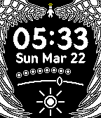</a>

<h2 class="app-name" id="app-6829ed79e282b00009e55256"><a href="https://apps.repebble.com/6829ed79e282b00009e55256">Angelic Ascent</a> v1.0</h2>
<a class="app-source" href="https://github.com/HarrisonAllen/angels-and-demons" title="Source code" data-search-exclude>View source</a>

Watchface

No licence Released 2025-05-18 Updated 2025-05-18

Runs on: Round 2, Time 2, Pebble 2 Duo, Pebble 2, Time Round, Time, Classic

Embrace your inner angel with Angelic Ascent, with the following features: * Time * Date * Weather * Temperature * Shown as a range from very cold (30F) to very hot(100F), with comfortable (65F)…

<a class="app-shot" href="https://apps.repebble.com/67cd9987d2acb302d5ba822e" data-search-exclude>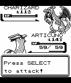</a>

<h2 class="app-name" id="app-67cd9987d2acb302d5ba822e"><a href="https://apps.repebble.com/67cd9987d2acb302d5ba822e">Pebblemon Lite</a> v1.0</h2>
<a class="app-source" href="https://github.com/HarrisonAllen/pebble-gbc-graphics-demo/tree/master/pebblemon-lite" title="Source code" data-search-exclude>View source</a>

App

MIT Released 2025-03-09 Updated 2025-03-09

Runs on: Time 2, Pebble 2 Duo, Pebble 2, Time, Classic

Pebblemon Lite! A bite-sized Pokemon adventure on your wrist. Pebblemon finally comes to the Pebble Classic and Pebble Steel! It&#x27;s a much smaller experience than the original Pebblemon, but you…

<a class="app-shot" href="https://apps.repebble.com/67cb6475b7a023020c5d6602" data-search-exclude>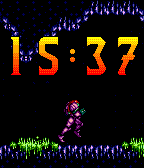</a>

<h2 class="app-name" id="app-67cb6475b7a023020c5d6602"><a href="https://apps.repebble.com/67cb6475b7a023020c5d6602">Super Metroid - Retro Series</a> v1.2</h2>
<a class="app-source" href="https://github.com/HarrisonAllen/retro-watchfaces/tree/main/Metroid/Super%20Metroid" title="Source code" data-search-exclude>View source</a>

Watchface

No licence Released 2025-03-07 Updated 2025-03-08

Runs on: Round 2, Time 2, Time Round, Time

Super Metroid - Retro Series Fly back to 1994 with Samus Aran with this Super Metroid watchface. Part of the Retro Series, join this bounty hunter as she navigates the interior of Zebes…

<a class="app-shot" href="https://apps.rebble.io/en_US/application/67bd83c5691e55000aa48ce2" data-search-exclude>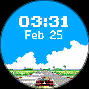</a>

<h2 class="app-name" id="app-67bd83c5691e55000aa48ce2"><a href="https://apps.rebble.io/en_US/application/67bd83c5691e55000aa48ce2">Passing Breeze Round</a> v1.0</h2>
<a class="app-source" href="https://github.com/HarrisonAllen/pebble-community-watchfaces/tree/main/outrun_port" title="Source code" data-search-exclude>View source</a>

Watchface

No licence Released 2025-02-25 Updated 2025-02-25 Rebble App Store

Runs on: Round 2, Time Round

Passing Breeze (an OutRun inspired watchface) has finally come to the Time Round! This is a port of the original watchface by MicroByte. This watchface was requested by Twebe Bebe on the Rebble…

<h2 class="app-name" id="app-67b3078d4d435400094659b7"><a href="https://apps.repebble.com/67b3078d4d435400094659b7">Gawr Gura - Hololive</a> v1.0</h2>
<a class="app-source" href="https://github.com/HarrisonAllen/pebble-community-watchfaces/tree/main/gawr_gura" title="Source code" data-search-exclude>View source</a>

Watchface

No licence Released 2025-02-17 Updated 2025-02-17

Runs on: Round 2, Time 2, Pebble 2 Duo, Pebble 2, Time Round, Time, Classic

Say hi to popular Hololive vtuber Gawr Gura! Made for MarnieFan89 on reddit.

<h2 class="app-name" id="app-67a908217cb65800093e3c06"><a href="https://apps.repebble.com/67a908217cb65800093e3c06">Hollow Knight</a> v1.0</h2>
<a class="app-source" href="https://github.com/HarrisonAllen/pebble-hollow-knight-watchface" title="Source code" data-search-exclude>View source</a>

Watchface

No licence Released 2025-02-09 Updated 2025-02-09

Runs on: Round 2, Time 2, Pebble 2 Duo, Pebble 2, Time Round, Time, Classic

Hollow Knight came out after Pebble met it&#x27;s end, so it never made an appearance on any watches... Until now. This simple watchface features a startup animation of the knight. Made using some…

<a class="app-shot" href="https://apps.repebble.com/64b6c9e21b3bd802ce74bee2" data-search-exclude>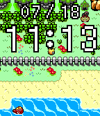</a>

<h2 class="app-name" id="app-64b6c9e21b3bd802ce74bee2"><a href="https://apps.repebble.com/64b6c9e21b3bd802ce74bee2">Pokemon Gen 2 - Retro Series</a> v1.0</h2>
<a class="app-source" href="https://github.com/HarrisonAllen/retro-watchfaces/tree/main/Pokemon/Gen2" title="Source code" data-search-exclude>View source</a>

Watchface

No licence Released 2023-07-18 Updated 2023-07-18

Runs on: Round 2, Time 2, Pebble 2 Duo, Pebble 2, Time Round, Time

Choose your Pokemon! This animated watchface lets you travel in the Johto region with up to 3 Pokemon by your side. Featuring the second generation of Pokemon, this watchface pays homage to the…

<a class="app-shot" href="https://apps.repebble.com/64b302471b3bd800327302c2" data-search-exclude>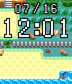</a>

<h2 class="app-name" id="app-64b302471b3bd800327302c2"><a href="https://apps.repebble.com/64b302471b3bd800327302c2">Pokemon Gen 1 - Retro Series</a> v1.2</h2>
<a class="app-source" href="https://github.com/HarrisonAllen/retro-watchfaces/tree/main/Pokemon/Gen1" title="Source code" data-search-exclude>View source</a>

Watchface

No licence Released 2023-07-15 Updated 2023-07-16

Runs on: Round 2, Time 2, Pebble 2 Duo, Pebble 2, Time Round, Time

Choose your Pokemon! This animated watchface lets you travel in the Kanto region with up to 3 Pokemon by your side. Featuring all 151 of the first generation of Pokemon, this watchface pays homage…

<a class="app-shot" href="https://apps.repebble.com/64a4bb81a474e20087825242" data-search-exclude>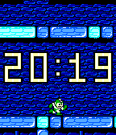</a>

<h2 class="app-name" id="app-64a4bb81a474e20087825242"><a href="https://apps.repebble.com/64a4bb81a474e20087825242">Mega Man 2 - Retro Series</a> v1.0</h2>
<a class="app-source" href="https://github.com/HarrisonAllen/retro-watchfaces/tree/main/Mega%20Man/Mega%20Man%202" title="Source code" data-search-exclude>View source</a>

Watchface

No licence Released 2023-07-05 Updated 2023-07-05

Runs on: Round 2, Time 2, Pebble 2 Duo, Pebble 2, Time Round, Time

Mega Man 2 - Retro Series Take a trip back in time to 1988 with this Mega Man 2 watchface. Part of the Retro Series, this watchface travels through each of the eight stages. Mega Man will step…

<a class="app-shot" href="https://apps.repebble.com/64a4291fc8c94800c6c0a1ef" data-search-exclude>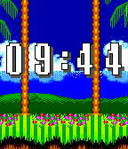</a>

<h2 class="app-name" id="app-64a4291fc8c94800c6c0a1ef"><a href="https://apps.repebble.com/64a4291fc8c94800c6c0a1ef">Sonic the Hedgehog 2 - Retro Series</a> v1.0</h2>
<a class="app-source" href="https://github.com/HarrisonAllen/retro-watchfaces/tree/main/SonicTheHedgehog/SonicTheHedgehog2" title="Source code" data-search-exclude>View source</a>

Watchface

No licence Released 2023-07-04 Updated 2023-07-04

Runs on: Round 2, Time 2, Pebble 2 Duo, Pebble 2, Time Round, Time

Sonic the Hedgehog 2 - Retro Series Take a trip back in time to 1992 with this Sonic the Hedgehog 2 watchface. Part of the Retro Series, this watchface will take you through three zones: Emerald…

<a class="app-shot" href="https://apps.repebble.com/649d7db808d66406ee6dfc3b" data-search-exclude>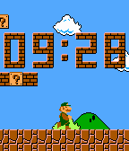</a>

<h2 class="app-name" id="app-649d7db808d66406ee6dfc3b"><a href="https://apps.repebble.com/649d7db808d66406ee6dfc3b">Super Mario Bros. - Retro Series</a> v1.0</h2>
<a class="app-source" href="https://github.com/HarrisonAllen/retro-watchfaces/tree/main/Mario/Super%20Mario%20Bros" title="Source code" data-search-exclude>View source</a>

Watchface

No licence Released 2023-06-29 Updated 2023-06-29

Runs on: Round 2, Time 2, Pebble 2 Duo, Pebble 2, Time Round, Time, Classic

Take a trip back in time to 1985 with this Super Mario Bros. watchface. Part of the Retro Series, this watchface walks through a small piece of the mushroom kingdom. Mario or Luigi will take a…

<a class="app-shot" href="https://apps.repebble.com/60eff8e81342ae009770ca32" data-search-exclude>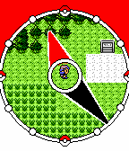</a>

<h2 class="app-name" id="app-60eff8e81342ae009770ca32"><a href="https://apps.repebble.com/60eff8e81342ae009770ca32">Pebblemon Time</a> v2.0</h2>
<a class="app-source" href="https://github.com/HarrisonAllen/pebblemon-watchface" title="Source code" data-search-exclude>View source</a>

Watchface

No licence Released 2021-07-15 Updated 2021-07-27

Runs on: Round 2, Time 2, Pebble 2 Duo, Pebble 2, Time Round, Time, Classic

Pebblemon Time! Explore the Pokémon world of Pebblemon, but with a twist: the watchface does all the exploring for you! Every minute, your character will take another step forward through the…

<h2 class="app-name" id="app-60fed69f1342ae020c35a654"><a href="https://apps.repebble.com/60fed69f1342ae020c35a654">Tiny Pilot</a> v1.0</h2>
<a class="app-source" href="https://github.com/HarrisonAllen/pebble-gbc-graphics" title="Source code" data-search-exclude>View source</a>

App

No licence Released 2021-07-26 Updated 2021-07-26

Runs on: Round 2, Time 2, Pebble 2 Duo, Pebble 2, Time Round, Time, Classic

Tiny Pilot is a game where you fly a tiny plane and collect as many balloons as you can before you run out of fuel! This is powered by the Pebble GBC Graphics engine, a library that allows you to…

<h2 class="app-name" id="app-60be7c361342ae006e50f2da"><a href="https://apps.repebble.com/60be7c361342ae006e50f2da">eccentric</a> v2.0</h2>
<a class="app-source" href="https://github.com/HarrisonAllen/eccentric" title="Source code" data-search-exclude>View source</a>

Watchface

MIT Released 2021-06-07 Updated 2021-07-26

Runs on: Round 2, Time 2, Pebble 2 Duo, Pebble 2, Time Round, Time, Classic

Lightweight. Simple. Abstract. eccentric

<h2 class="app-name" id="app-60147aa91342ae0272a62d2b"><a href="https://apps.repebble.com/60147aa91342ae0272a62d2b">Simply Sheikah</a> v1.0</h2>
<a class="app-source" href="https://git.lil-oasis.com/LinkSky/SimplySheikah_PebbleWatchface" title="Source code" data-search-exclude>View source</a>

Watchface

Released 2021-01-29 Updated 2021-01-29

Runs on: Round 2, Time 2, Pebble 2 Duo, Pebble 2, Time Round, Time, Classic

An elegant, simple watchface with a taste of The Legend of Zelda: Breath of the Wild featuring the Sheikah eye symbol. Features: -Time and Date -Battery life indicated by the triangles at the top…

