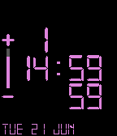
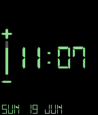
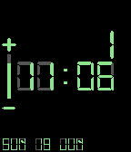

<!-- Generated by scripts/update_app_directory.py: do not edit by hand -->
[← All Pebble Developers](../developers.md)

# Hat

*3 watchfaces · Last updated 2026-10-12 · [About these lists](../about-app-lists.md)*

Links: [Pebble App Store](https://apps.repebble.com/apps/dev/hat_5765431e0cc8f54d250000a4) · [GitHub (TheYellowHat)](https://github.com/TheYellowHat)

<button type="button" data-filter="all" aria-pressed="true">All 3</button><button type="button" data-filter="watchface" aria-pressed="false">Watchfaces 3</button><button type="button" data-filter="watchapp" aria-pressed="false" disabled>Apps 0</button>

<label class="dev-sort">Sort by <select><option value="updated">Recently updated</option><option value="released">Newest release</option><option value="title">A–Z</option></select></label>

<h2 class="app-name" id="app-5769298e3feaee189f0004a7"><a href="https://apps.repebble.com/5769298e3feaee189f0004a7">Watch it Calculate V2</a> v1.0</h2>
<a class="app-source" href="https://github.com/TheYellowHat/Watch-It-Calculate-V2" title="Source code" data-search-exclude>View source</a>

Watchface

No licence Released 2016-06-21 Updated 2016-06-21

Runs on: Round 2, Time 2, Pebble 2 Duo, Pebble 2, Time Round, Time, Classic

*Just in case* There are simpler versions of this WatchFace on the appstore called, you guessed it, &#x27;Watch It Calculate&#x27; and &#x27;Watch It Calculate Minus.&#x27; Go ahead and check them out. A simple yet…

<h2 class="app-name" id="app-576754903feaee4aa30002b8"><a href="https://apps.repebble.com/576754903feaee4aa30002b8">Watch It Calculate Minus</a> v1.0</h2>
<a class="app-source" href="https://github.com/TheYellowHat/Watch-It-Calculate-Minus" title="Source code" data-search-exclude>View source</a>

Watchface

MIT Released 2016-06-20 Updated 2016-06-20

Runs on: Round 2, Time 2, Pebble 2 Duo, Pebble 2, Time Round, Time, Classic

*Just in case* If you don&#x27;t like the plain background for both the time and date, check out my other apps for a different build. &#x27;Watch It Calculate&#x27;, just like mama used to make. It might suit…

<h2 class="app-name" id="app-57675ca63feaee1b800002f3"><a href="https://apps.repebble.com/57675ca63feaee1b800002f3">Watch it Calculate</a> v1.0</h2>
<a class="app-source" href="https://github.com/TheYellowHat/Watch-It-Calculate" title="Source code" data-search-exclude>View source</a>

Watchface

MIT Released 2016-06-20 Updated 2016-06-20

Runs on: Round 2, Time 2, Pebble 2 Duo, Pebble 2, Time Round, Time, Classic

*Just in case* If you don&#x27;t like the gray calculator-like background for both the time and date, check out my other apps for a different build. &#x27;Watch It Calculate Minus&#x27;. It might suit your…

