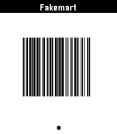

<!-- Generated by scripts/update_app_directory.py: do not edit by hand -->
[← All Pebble Developers](../developers.md)

# Hazel Atkinson

*1 app · Last updated 2026-10-12 · [About these lists](../about-app-lists.md)*

Links: [Pebble App Store](https://apps.repebble.com/apps/dev/hazel-atkinson_6a0b2376caa042000991a382) · [GitHub (yellowsink)](https://github.com/yellowsink) · [Website (yellows.ink)](https://yellows.ink)

<h2 class="app-name" id="app-6a10bbd87d641e0009ce6a58"><a href="https://apps.repebble.com/6a10bbd87d641e0009ce6a58">kijete</a> v1.9.0</h2>
<a class="app-source" href="https://github.com/yellowsink/kijete/" title="Source code" data-search-exclude>View source</a>

App · <a href="https://forum.rebble.io/t/993" title="Discuss this app on the Rebble forum" data-search-exclude>Forum thread</a>

Released 2026-05-22 Updated 2026-05-22

Runs on: Time 2, Pebble 2 Duo, Pebble 2, Time, Classic

kijete is an app for Pebble that allows you to display Code 128, Aztec, Data Matrix, PDF417, and QR codes on your wrist. It is a fork of Skunk by Harley Watson, and is so named because in toki…

