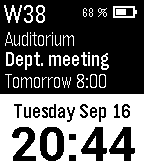

<!-- Generated by scripts/update_app_directory.py: do not edit by hand -->
[← All Pebble Developers](../developers.md)

# HBTeicher

*2 watchfaces · Last updated 2026-10-12 · [About these lists](../about-app-lists.md)*

Links: [Rebble App Store](https://apps.rebble.io/en_US/developer/52f009f13be62018d800009b/1) · [Pebble App Store](https://apps.repebble.com/apps/dev/hbteicher_52f009f13be62018d800009b) · [GitHub (HBTeicher)](https://github.com/HBTeicher) · [Website (thepebbleblog.blogspot.dk)](http://thepebbleblog.blogspot.dk/)

<button type="button" data-filter="all" aria-pressed="true">All 2</button><button type="button" data-filter="watchface" aria-pressed="false">Watchfaces 2</button><button type="button" data-filter="watchapp" aria-pressed="false" disabled>Apps 0</button>

<label class="dev-sort">Sort by <select><option value="updated">Recently updated</option><option value="released">Newest release</option><option value="title">A–Z</option></select></label>

<h2 class="app-name" id="app-533c6b6445188e7236000061"><a href="https://apps.rebble.io/en_US/application/533c6b6445188e7236000061">SimplicityPro</a> v2.4</h2>
<a class="app-source" href="https://github.com/HBTeicher/SimplicityPro_2.0" title="Source code" data-search-exclude>View source</a>

Watchface

No licence Released 2014-04-02 Updated 2014-10-17 Rebble App Store

Runs on: Time 2, Pebble 2 Duo, Pebble 2, Time, Classic

The Project Management companion watchface for SMARTWATCH PRO! Modified version of SIMPLICITY by Max Bäumle and SIMPLICITY BY CM, optimization by Aaron Clymer. - Time, Day, Date &amp; Weeknumber …

<h2 class="app-name" id="app-53d28f9c15466c6e5e000053"><a href="https://apps.repebble.com/53d28f9c15466c6e5e000053">Ninety_Hank_DK</a> v2.0</h2>
<a class="app-source" href="https://github.com/HBTeicher/Ninety_Hank_DK" title="Source code" data-search-exclude>View source</a>

Watchface

No licence Released 2014-07-25 Updated 2014-07-25

Runs on: Time 2, Pebble 2 Duo, Pebble 2, Time, Classic

Danish version of Ninety_Hank by Hank, based on 91 Dub. Useful for planning my morning/evening runs before darkness falls! -Sunrise/set for 56.7° N, 8.2° E (Thyborøn) -Moonphase -BT/battery…

