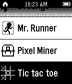

<!-- Generated by scripts/update_app_directory.py: do not edit by hand -->
[← All Pebble Developers](../developers.md)

# HeatBorn

*1 app · Last updated 2026-10-12 · [About these lists](../about-app-lists.md)*

Links: [Pebble App Store](https://apps.repebble.com/apps/dev/heatborn_554764fe859050c791000029)

<h2 class="app-name" id="app-5573606078821148190000b0"><a href="https://apps.repebble.com/5573606078821148190000b0">Tic Tac Toe</a> v1.1</h2>
<a class="app-source" href="https://cloudpebble.net/ide/project/194955#" title="Source code" data-search-exclude>View source</a>

App

Released 2015-06-06 Updated 2015-07-13

Runs on: Time 2, Pebble 2 Duo, Pebble 2, Time, Classic

A 1 v 1 battle between 2 players! This REQUIRES at least one pebble (note: at the moment there is no way to use two pebble devices).

