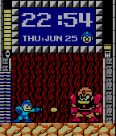

<!-- Generated by scripts/update_app_directory.py: do not edit by hand -->
[← All Pebble Developers](../developers.md)

# Hedgehogs265

*1 watchface · Last updated 2026-10-11 · [About these lists](../about-app-lists.md)*

Links: [Pebble App Store](https://apps.repebble.com/apps/dev/hedgehogs265_53ada5606b4f8e25c50003b2) · [GitHub (sethruji)](https://github.com/sethruji)

<h2 class="app-name" id="app-558cb4fcdf1af0306e000044"><a href="https://apps.repebble.com/558cb4fcdf1af0306e000044">Megaman Time</a> v1.2</h2>
<a class="app-source" href="https://github.com/sethruji/MegamanTime" title="Source code" data-search-exclude>View source</a>

Watchface

Released 2015-06-26 Updated 2015-06-26

Runs on: Time 2, Time

*Currently there is a bug that causes the face to not properly stay at the selected boss and power up. I will get to this issue as soon as I have the chance but I&#x27;m limited on time currently…

