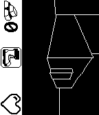

<!-- Generated by scripts/update_app_directory.py: do not edit by hand -->
[← All Pebble Developers](../developers.md)

# Helco

*1 watchface and 1 app · Last updated 2026-10-11 · [About these lists](../about-app-lists.md)*

Links: [Pebble App Store](https://apps.repebble.com/apps/dev/helco_53205de12d3c7bdc620000ed) · [GitHub (Helco)](https://github.com/Helco)

<button type="button" data-filter="all" aria-pressed="true">All 2</button><button type="button" data-filter="watchface" aria-pressed="false">Watchfaces 1</button><button type="button" data-filter="watchapp" aria-pressed="false">Apps 1</button>

<label class="dev-sort">Sort by <select><option value="updated">Recently updated</option><option value="released">Newest release</option><option value="title">A–Z</option></select></label>

<h2 class="app-name" id="app-63823894c6c24a000a815f17"><a href="https://apps.repebble.com/63823894c6c24a000a815f17">Searching Emery</a> v1.0</h2>
<a class="app-source" href="https://github.com/Helco/PebbleOfDoom/tree/searching-emery" title="Source code" data-search-exclude>View source</a>

App

MIT Released 2022-11-26 Updated 2022-11-26

Runs on: Time 2, Pebble 2 Duo, Pebble 2, Time

A small 3D game about almost-alive watches. Made (almost) during Rebble Hackathon-001

<h2 class="app-name" id="app-54d8d7cf05db7b86c600008a"><a href="https://apps.repebble.com/54d8d7cf05db7b86c600008a">VaultBoy</a> v2.1</h2>
<a class="app-source" href="https://github.com/Helco/VaultBoyWatchface" title="Source code" data-search-exclude>View source</a>

Watchface

No licence Released 2015-02-09 Updated 2015-09-22

Runs on: Time 2, Pebble 2 Duo, Pebble 2, Time, Classic

For your survival in the post-apocalyptic world. Inspired by the watch your character of Fallout 3 wears in the Tranquility Lane. You can now wear this beauty (black-white) on your trusted pebble…

