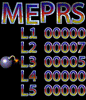

<!-- Generated by scripts/update_app_directory.py: do not edit by hand -->
[← All Pebble Developers](../developers.md)

# Henrik Gustavsson

*1 app · Last updated 2026-10-12 · [About these lists](../about-app-lists.md)*

Links: [Pebble App Store](https://apps.repebble.com/apps/dev/henrik-gustavsson_54f40c4a975f690b38000018) · [GitHub (HGustavs)](https://github.com/HGustavs)

<h2 class="app-name" id="app-56340377ffc90183ee00001e"><a href="https://apps.repebble.com/56340377ffc90183ee00001e">MEPRS - Mine Sweepers</a> v1.00</h2>
<a class="app-source" href="https://github.com/HGustavs/MEPRS" title="Source code" data-search-exclude>View source</a>

App

GPL-2.0 Released 2015-10-30 Updated 2015-10-31

Runs on: Time 2, Time

MEPRS is a variation of the classic Mine Sweeper game. It has colorful graphics and a persistent high-score table and five different levels with increasing difficulty. As the application only…

