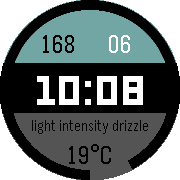

<!-- Generated by scripts/update_app_directory.py: do not edit by hand -->
[← All Pebble Developers](../developers.md)

# Heron

*1 watchface · Last updated 2026-10-12 · [About these lists](../about-app-lists.md)*

Links: [Pebble App Store](https://apps.repebble.com/apps/dev/heron_550b12416aa533e72200004d) · [GitHub (heronyang)](https://github.com/heronyang) · [Website (heron.me)](http://www.heron.me)

<h2 class="app-name" id="app-56dcd4aa5049a7d122000044"><a href="https://apps.repebble.com/56dcd4aa5049a7d122000044">Count Days</a> v2.0</h2>
<a class="app-source" href="https://github.com/heronyang/countdays" title="Source code" data-search-exclude>View source</a>

Watchface

No licence Released 2016-03-07 Updated 2016-03-07

Runs on: Round 2, Time Round

Shows the day count to/from your dream day. (with Solar Ring design like the Apple&#x27;s)

