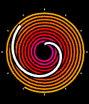

<!-- Generated by scripts/update_app_directory.py: do not edit by hand -->
[← All Pebble Developers](../developers.md)

# hexahedria

*1 watchface · Last updated 2026-10-12 · [About these lists](../about-app-lists.md)*

Links: [Pebble App Store](https://apps.repebble.com/apps/dev/hexahedria_533131a7ff3a27c655000105) · [GitHub (hexahedria)](https://github.com/hexahedria) · [Website (hexahedria.com)](http://www.hexahedria.com)

<h2 class="app-name" id="app-57ae8921bb85ed9aa5000310"><a href="https://apps.repebble.com/57ae8921bb85ed9aa5000310">Continuous Spiral Clock</a> v1.0</h2>
<a class="app-source" href="https://github.com/hexahedria/spiral-watchface" title="Source code" data-search-exclude>View source</a>

Watchface

No licence Released 2016-08-13 Updated 2016-08-13

Runs on: Round 2, Time 2, Pebble 2 Duo, Pebble 2, Time Round, Time, Classic

Watchface that shows the time with a continuous spiral. Outer spiral completes a revolution every hour, and inner spiral completes a revolution every 12 hours. How to read: Outer endpoint of the…

