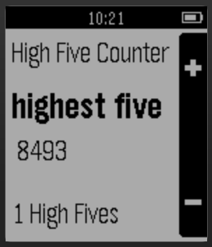

<!-- Generated by scripts/update_app_directory.py: do not edit by hand -->
[← All Pebble Developers](../developers.md)

# Highest Five

*1 app · Last updated 2026-10-12 · [About these lists](../about-app-lists.md)*

Links: [Pebble App Store](https://apps.repebble.com/apps/dev/highest-five_553bc93eb894567592000094) · [GitHub (thegrumpybuffalo)](https://github.com/thegrumpybuffalo)

<h2 class="app-name" id="app-553d01b20c00e74822000051"><a href="https://apps.repebble.com/553d01b20c00e74822000051">Highest Five</a> v1.1</h2>
<a class="app-source" href="https://github.com/thegrumpybuffalo/HighestFive" title="Source code" data-search-exclude>View source</a>

App

Released 2015-04-26 Updated 2015-04-26

Runs on: Time 2, Pebble 2 Duo, Pebble 2, Time, Classic

Track your high fives*! Not only the number, but also the force with which you can high five your friends! * We are not responsible for any self-inflicted harm that comes from your attempting to…

