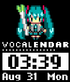

<!-- Generated by scripts/update_app_directory.py: do not edit by hand -->
[← All Pebble Developers](../developers.md)

# HMML

*1 watchface · Last updated 2026-10-12 · [About these lists](../about-app-lists.md)*

Links: [Pebble App Store](https://apps.repebble.com/apps/dev/hmml_55d0883c35a72bb4d5000001)

<h2 class="app-name" id="app-55e3445a4af009db9f00003b"><a href="https://apps.repebble.com/55e3445a4af009db9f00003b">Pixel Miku - VOCALENDAR</a> v1.1</h2>
<a class="app-source" href="https://osdn.jp/users/hmml/pf/pebble_miku_vocalendar/" title="Source code" data-search-exclude>View source</a>

Watchface

Released 2015-08-30 Updated 2015-11-05

Runs on: Time 2, Time

Pixel Miku - VOCALENDAR is a simple watchface. The pixel arts are provided by VOCALENDAR project(*1). Pixel Miku - VOCALENDAR はドット絵ミクさんを表示するシンプルな watchface です。 ドット絵は VOCALRNDAR…

