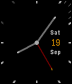

<!-- Generated by scripts/update_app_directory.py: do not edit by hand -->
[← All Pebble Developers](../developers.md)

# HockWoo Tan

*1 watchface · Last updated 2026-10-11 · [About these lists](../about-app-lists.md)*

Links: [Pebble App Store](https://apps.repebble.com/apps/dev/hockwoo-tan_52f2c3ab341bc1eadd000018) · [GitHub (hw)](https://github.com/hw)

<h2 class="app-name" id="app-55fd507cf1f7ea175900005f"><a href="https://apps.repebble.com/55fd507cf1f7ea175900005f">Thin Markers</a> v0.2</h2>
<a class="app-source" href="https://github.com/hw/thin" title="Source code" data-search-exclude>View source</a>

Watchface

Released 2015-09-19 Updated 2025-12-01

Runs on: Time 2, Pebble 2 Duo, Pebble 2, Time, Classic

A simple watch face based on the Thin watch face by C. Lewis, with added markers to aid more precise reading of the current time, and ability to configure the colour of watch hands and markers. **…

