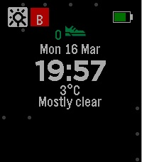

<!-- Generated by scripts/update_app_directory.py: do not edit by hand -->
[← All Pebble Developers](../developers.md)

# homecafe

*1 watchface · Last updated 2026-10-12 · [About these lists](../about-app-lists.md)*

Links: [Rebble App Store](https://apps.rebble.io/en_US/developer/5b2619b8fbaf9a5d3900037d/1) · [GitHub (pebble-examples)](https://github.com/pebble-examples)

<h2 class="app-name" id="app-69b64dd51645ed000a4fb1fd"><a href="https://apps.rebble.io/en_US/application/69b64dd51645ed000a4fb1fd">Wdustride</a> v1.7</h2>
<a class="app-source" href="https://github.com/pebble-examples/health-watchface" title="Source code" data-search-exclude>View source</a>

Watchface · <a href="https://forum.rebble.io/t/771" title="Discuss this app on the Rebble forum" data-search-exclude>Forum thread</a>

Released 2026-03-15 Updated 2026-04-09 Rebble App Store

Runs on: Round 2, Time 2, Pebble 2 Duo, Pebble 2, Time Round, Time, Classic

weather dust stride app dust shows - G(ood), N(ormal), B(ad), V(ery Bad)

