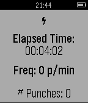

<!-- Generated by scripts/update_app_directory.py: do not edit by hand -->
[← All Pebble Developers](../developers.md)

# Hongyu Chen

*1 app · Last updated 2026-10-12 · [About these lists](../about-app-lists.md)*

Links: [Pebble App Store](https://apps.repebble.com/apps/dev/hongyu-chen_53dd3af5f7d22224c8000028) · [GitHub (hongyuchen)](https://github.com/hongyuchen) · [Website (cs.dartmouth.edu)](http://www.cs.dartmouth.edu/~xan/Jab/)

<h2 class="app-name" id="app-5529cf1a05b83a307900009e"><a href="https://apps.repebble.com/5529cf1a05b83a307900009e">Jab</a> v1.0</h2>
<a class="app-source" href="https://github.com/hongyuchen/jab" title="Source code" data-search-exclude>View source</a>

App

No licence Released 2015-04-12 Updated 2015-04-12

Runs on: Time 2, Pebble 2 Duo, Pebble 2, Time, Classic

Until now, measuring improvement and tracking performance for punch-based athletics were difficult tasks, measured only by the face of your opponents. Now with Jab, an app for the Pebble…

