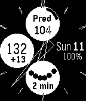

<!-- Generated by scripts/update_app_directory.py: do not edit by hand -->
[← All Pebble Developers](../developers.md)

# Horsetooth Software

*1 watchface · Last updated 2026-10-11 · [About these lists](../about-app-lists.md)*

Links: [Pebble App Store](https://apps.repebble.com/apps/dev/horsetooth-software_5781515d66202aae4000055f) · [GitHub (tynbendad)](https://github.com/tynbendad)

<h2 class="app-name" id="app-578c21b584accc314e0002bf"><a href="https://apps.repebble.com/578c21b584accc314e0002bf">Simple CGM Analog</a> v1.9</h2>
<a class="app-source" href="https://github.com/tynbendad/simplecgmanalog" title="Source code" data-search-exclude>View source</a>

Watchface

Released 2016-07-18 Updated 2019-07-24

Runs on: Round 2, Time 2, Pebble 2 Duo, Pebble 2, Time Round, Time, Classic

Please send email (through pebble store contact link) if you try it &amp; have issues or suggestions. Based nearly entirely on John Costik&#x27;s SIMPLE CGM SPARK watchface - all kudos to him, all blame to…

