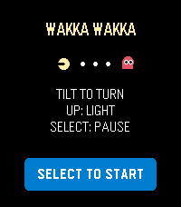

<!-- Generated by scripts/update_app_directory.py: do not edit by hand -->
[← All Pebble Developers](../developers.md)

# howardpchen

*1 app · Last updated 2026-10-12 · [About these lists](../about-app-lists.md)*

Links: [Pebble App Store](https://apps.repebble.com/apps/dev/howardpchen_3b814c86959675637d4319b8) · [GitHub (howardpchen)](https://github.com/howardpchen)

<h2 class="app-name" id="app-d7730c67fb89412e9c655cfd"><a href="https://apps.repebble.com/d7730c67fb89412e9c655cfd">Wakka Wakka</a> v1.1.0</h2>
<a class="app-source" href="https://github.com/howardpchen/wakka-wakka" title="Source code" data-search-exclude>View source</a>

App

MIT Released 2026-07-28 Updated 2026-07-29

Runs on: Time 2, Time

Wakka Wakka is a compact maze-chase game designed for Pebble Time 2. Guide a quick golden runner through a scrolling stage by tilting your wrist. Clear every energy dot while four colorful rivals…

