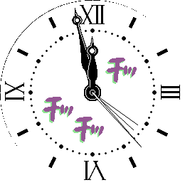
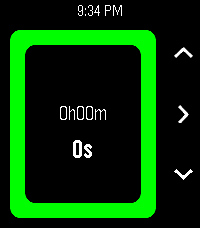
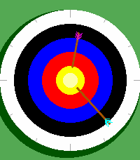

<!-- Generated by scripts/update_app_directory.py: do not edit by hand -->
[← All Pebble Developers](../developers.md)

# howeaj

*2 watchfaces and 1 app · Last updated 2026-10-12 · [About these lists](../about-app-lists.md)*

Links: [Pebble App Store](https://apps.repebble.com/apps/dev/howeaj_985832377863a3ae441861fe) · [GitHub (howeaj)](https://github.com/howeaj)

<button type="button" data-filter="all" aria-pressed="true">All 3</button><button type="button" data-filter="watchface" aria-pressed="false">Watchfaces 2</button><button type="button" data-filter="watchapp" aria-pressed="false">Apps 1</button>

<label class="dev-sort">Sort by <select><option value="updated">Recently updated</option><option value="released">Newest release</option><option value="title">A–Z</option></select></label>

<h2 class="app-name" id="app-168358eb358e48358c693060"><a href="https://apps.repebble.com/168358eb358e48358c693060">Hol Horse</a> v1.0.0</h2>
<a class="app-source" href="https://github.com/howeaj/pebble-hol-horse" title="Source code" data-search-exclude>View source</a>

Watchface

GPL-3.0 Released 2026-10-11 Updated 2026-10-11

Runs on: Round 2

Analogue watch used by Hol Horse from Jojo&#x27;s Bizarre Adventure. Shake to show seconds and 3 custom complications; very configurable! Tags: roman numerals, round, anime, manga, novelty, functional…

<h2 class="app-name" id="app-1a42bf7ed056404abbdd7bf9"><a href="https://apps.repebble.com/1a42bf7ed056404abbdd7bf9">Timer - Instant Timer</a> v2.8.0</h2>
<a class="app-source" href="https://github.com/howeaj/pebble-instant-timer" title="Source code" data-search-exclude>View source</a>

App · <a href="https://forum.rebble.io/t/849" title="Discuss this app on the Rebble forum" data-search-exclude>Forum thread</a>

GPL-3.0 Released 2026-04-08 Updated 2026-07-19

Runs on: Round 2, Time 2, Pebble 2 Duo, Pebble 2, Time Round, Time, Classic

A polished combination timer, alarm and stopwatch. Designed for quick-launch to set everyday timers/alarms for cooking, reminders and alarm clocks. Packed with unique, detailed behaviour to…

<h2 class="app-name" id="app-fe84cab39618424480b5b4f6"><a href="https://apps.repebble.com/fe84cab39618424480b5b4f6">Archery</a> v1.10</h2>
<a class="app-source" href="https://github.com/howeaj/pebble-archery" title="Source code" data-search-exclude>View source</a>

Watchface

GPL-3.0 Released 2026-04-12 Updated 2026-04-25

Runs on: Round 2, Time 2, Pebble 2 Duo, Pebble 2, Time Round, Time, Classic

Watch out! Tiny archers are shooting your wrist! Luckily, the arrows conveniently point to the current time. Their aim is a bit off, but if you can figure out how to help them, you may be…

