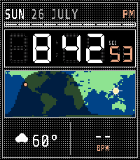
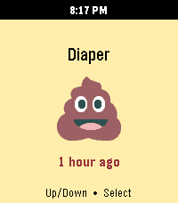

<!-- Generated by scripts/update_app_directory.py: do not edit by hand -->
[← All Pebble Developers](../developers.md)

# Hoyt Labs

*1 watchface and 1 app · Last updated 2026-10-12 · [About these lists](../about-app-lists.md)*

Links: [Pebble App Store](https://apps.repebble.com/apps/dev/hoyt-labs_2c7cc63cb80aec6744597cfb) · [GitHub (michaellunzer)](https://github.com/michaellunzer)

<button type="button" data-filter="all" aria-pressed="true">All 2</button><button type="button" data-filter="watchface" aria-pressed="false">Watchfaces 1</button><button type="button" data-filter="watchapp" aria-pressed="false">Apps 1</button>

<label class="dev-sort">Sort by <select><option value="updated">Recently updated</option><option value="released">Newest release</option><option value="title">A–Z</option></select></label>

<h2 class="app-name" id="app-8202d29e6aea4d93ab507208"><a href="https://apps.repebble.com/8202d29e6aea4d93ab507208">LCD Worldtime</a> v1.1.0</h2>
<a class="app-source" href="https://github.com/michaellunzer/pebble-lcd-worldtime" title="Source code" data-search-exclude>View source</a>

Watchface

Released 2026-07-27 Updated 2026-07-27

Runs on: Time 2

LCD Worldtime A Casio-flavored LCD watchface with a live day/night world map. Watch the sun&#x27;s terminator sweep across the globe in real time, with a marker on your home city and the subsolar point…

<h2 class="app-name" id="app-db88f247deb24c56bf7794f2"><a href="https://apps.repebble.com/db88f247deb24c56bf7794f2">Baby StoneFruit</a> v1.0.4</h2>
<a class="app-source" href="https://github.com/michaellunzer/babystonefruit" title="Source code" data-search-exclude>View source</a>

App

Released 2026-05-12 Updated 2026-05-22

Runs on: Round 2, Time 2

This is the Huckleberry baby tracking app on you Pebble! It uses the Home Assistant Huckleberry Integration as a proxy since a pebble watch can&#x27;t communicate with Huckleberry directly. It&#x27;s a…

