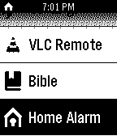

<!-- Generated by scripts/update_app_directory.py: do not edit by hand -->
[← All Pebble Developers](../developers.md)

# Hugo

*1 app · Last updated 2026-10-12 · [About these lists](../about-app-lists.md)*

Links: [Pebble App Store](https://apps.repebble.com/apps/dev/hugo_52cb234945ffdd4be8000048) · [GitHub (hugoender)](https://github.com/hugoender)

<h2 class="app-name" id="app-52dc7194f9d8ec503100003c"><a href="https://apps.repebble.com/52dc7194f9d8ec503100003c">Home Alarm Control for RPi</a> v2.0</h2>
<a class="app-source" href="https://github.com/hugoender/HomeAlarmRemotePebble/blob/master/README.md" title="Source code" data-search-exclude>View source</a>

App

No licence Released 2014-01-20 Updated 2014-01-20

Runs on: Time 2, Pebble 2 Duo, Pebble 2, Time, Classic

Requirements: Raspberry Pi with Webiopi installed. Allows you to control two GPIO pins on a Raspberry Pi to arm and disarm your home alarm. Each press of a button brings the user specified GPIO…

