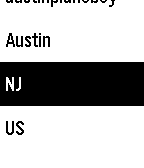

<!-- Generated by scripts/update_app_directory.py: do not edit by hand -->
[← All Pebble Developers](../developers.md)

# Hull Softworks (Austin Hull)

*1 app · Last updated 2026-10-11 · [About these lists](../about-app-lists.md)*

Links: [Pebble App Store](https://apps.repebble.com/apps/dev/hull-softworks-austin-hull_53a33bb92cfdbbb5ae00001f) · [GitHub (AustinHull)](https://github.com/AustinHull) · [Website (linkedin.com)](https://www.linkedin.com/in/austin-hull-b442bb10b)

<h2 class="app-name" id="app-56b91139226cb174f8000032"><a href="https://apps.repebble.com/56b91139226cb174f8000032">Wrist Steam</a> v1.0</h2>
<a class="app-source" href="https://www.github.com/AustinHull/SteamPebble" title="Source code" data-search-exclude>View source</a>

App

Released 2016-02-08 Updated 2017-05-14

Runs on: Time 2, Pebble 2 Duo, Pebble 2, Time, Classic

Wrist Steam is a free, open-source application built to help bridge the gap between Pebble users and their Steam profiles. In development since mid-2014, Wrist Steam allows you to safely - and…

