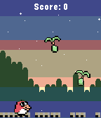
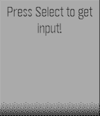

<!-- Generated by scripts/update_app_directory.py: do not edit by hand -->
[← All Pebble Developers](../developers.md)

# huntboom

*2 apps · Last updated 2026-10-12 · [About these lists](../about-app-lists.md)*

Links: [Pebble App Store](https://apps.repebble.com/apps/dev/huntboom_63590f2e40d3e00007cf6169) · [GitHub (huntboom)](https://github.com/huntboom) · [Website (hunterkarsseboom.com)](https://www.hunterkarsseboom.com)

<button type="button" data-filter="all" aria-pressed="true">All 2</button><button type="button" data-filter="watchface" aria-pressed="false" disabled>Watchfaces 0</button><button type="button" data-filter="watchapp" aria-pressed="false">Apps 2</button>

<label class="dev-sort">Sort by <select><option value="updated">Recently updated</option><option value="released">Newest release</option><option value="title">A–Z</option></select></label>

<h2 class="app-name" id="app-69de48d8ae7c00000a5493b6"><a href="https://apps.repebble.com/69de48d8ae7c00000a5493b6">pyoro</a> v1.0</h2>
<a class="app-source" href="https://github.com/huntboom/pyoropebble" title="Source code" data-search-exclude>View source</a>

App · <a href="https://forum.rebble.io/t/876" title="Discuss this app on the Rebble forum" data-search-exclude>Forum thread</a>

No licence Released 2026-04-14 Updated 2026-04-14

Runs on: Time 2, Pebble 2 Duo, Pebble 2, Time, Classic

This is a port/demake of the bird and beans pyoro game from the warioware minigame and DsiWare shop

<h2 class="app-name" id="app-64853961143b6504611fbc06"><a href="https://apps.repebble.com/64853961143b6504611fbc06">PebbleAI</a> v2.2</h2>
<a class="app-source" href="https://github.com/huntboom/PebbleAI" title="Source code" data-search-exclude>View source</a>

App

MIT Released 2023-06-11 Updated 2025-09-22

Runs on: Round 2, Time 2, Pebble 2 Duo, Pebble 2, Time Round, Time

ChatGPT, Gemini, DeepSeek, Grok or Claude for the Pebble Time! This app takes your voice message and displays a response from the AI assistant of your choice using their API. Requires an API key…

