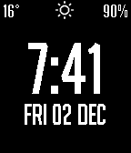

<!-- Generated by scripts/update_app_directory.py: do not edit by hand -->
[← All Pebble Developers](../developers.md)

# Huon Imberger

*1 watchface · Last updated 2026-10-12 · [About these lists](../about-app-lists.md)*

Links: [Pebble App Store](https://apps.repebble.com/apps/dev/huon-imberger_5832618700355ad84800015a) · [GitHub (Plonq)](https://github.com/Plonq)

<h2 class="app-name" id="app-5840ee6fca30949f470004e9"><a href="https://apps.repebble.com/5840ee6fca30949f470004e9">Essentials</a> v1.0</h2>
<a class="app-source" href="https://github.com/Plonq/Essentials" title="Source code" data-search-exclude>View source</a>

Watchface

No licence Released 2016-12-02 Updated 2016-12-16

Runs on: Time 2, Pebble 2 Duo, Pebble 2, Time

Nice big time, weather (DarkSky/forecast.io), battery, vibrate/icon on bluetooth disconnect. Configurable: DarkSky API key, Celcius/Fahrenheit, date format. Inspired by Clean &amp; Smart…

