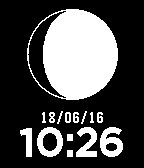
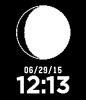

<!-- Generated by scripts/update_app_directory.py: do not edit by hand -->
[← All Pebble Developers](../developers.md)

# husobee apps

*2 watchfaces · Last updated 2026-10-12 · [About these lists](../about-app-lists.md)*

Links: [Pebble App Store](https://apps.repebble.com/apps/dev/husobee-apps_552f1c95c3416203bc000093) · [GitHub (husobee)](https://github.com/husobee)

<button type="button" data-filter="all" aria-pressed="true">All 2</button><button type="button" data-filter="watchface" aria-pressed="false">Watchfaces 2</button><button type="button" data-filter="watchapp" aria-pressed="false" disabled>Apps 0</button>

<label class="dev-sort">Sort by <select><option value="updated">Recently updated</option><option value="released">Newest release</option><option value="title">A–Z</option></select></label>

<h2 class="app-name" id="app-57654b610cc8f579730000a9"><a href="https://apps.repebble.com/57654b610cc8f579730000a9">Moon Phase Watchface UK</a> v1.0</h2>
<a class="app-source" href="https://github.com/husobee/pebble-moonphase-uk" title="Source code" data-search-exclude>View source</a>

Watchface

No licence Released 2016-06-18 Updated 2016-06-18

Runs on: Time 2, Pebble 2 Duo, Pebble 2, Time, Classic

This watchface is a slight modification of this: https://apps.getpebble.com/en_US/application/55916f52981ce4e960000069 The only difference is the date format follows the DD/MM/YY.

<h2 class="app-name" id="app-55916f52981ce4e960000069"><a href="https://apps.repebble.com/55916f52981ce4e960000069">Moon Phase Watchface</a> v1.1</h2>
<a class="app-source" href="https://github.com/husobee/pebble-moonphase" title="Source code" data-search-exclude>View source</a>

Watchface

No licence Released 2015-06-29 Updated 2015-07-02

Runs on: Time 2, Pebble 2 Duo, Pebble 2, Time, Classic

A watchface that will show you the current phase of the moon, as well as the current date and time.

