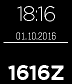

<!-- Generated by scripts/update_app_directory.py: do not edit by hand -->
[← All Pebble Developers](../developers.md)

# HXC9

*1 watchface · Last updated 2026-10-11 · [About these lists](../about-app-lists.md)*

Links: [Pebble App Store](https://apps.repebble.com/apps/dev/hxc9_52f16712e21be494030005d5) · [GitHub (hxc9)](https://github.com/hxc9)

<h2 class="app-name" id="app-57efe34d05e4b1020500019a"><a href="https://apps.repebble.com/57efe34d05e4b1020500019a">Simply Zulu</a> v1.0</h2>
<a class="app-source" href="https://github.com/hxc9/ZuluWatchface" title="Source code" data-search-exclude>View source</a>

Watchface

Released 2016-10-01 Updated 2017-01-24

Runs on: Round 2, Time 2, Pebble 2 Duo, Pebble 2, Time Round, Time, Classic

A simple watchface for pilots that displays both local (above) and Zulu/UTC (below) time, as well as date and battery level. The battery level is represented by the white line in the middle: it…

