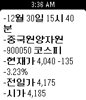

<!-- Generated by scripts/update_app_directory.py: do not edit by hand -->
[← All Pebble Developers](../developers.md)

# Hyunjoong Kim

*1 app · Last updated 2026-10-12 · [About these lists](../about-app-lists.md)*

Links: [Pebble App Store](https://apps.repebble.com/apps/dev/hyunjoong-kim_5646a183cadadbcca500002c) · [GitHub (82joong)](https://github.com/82joong) · [Website (blog.naver.com)](http://blog.naver.com/82joong/220586543068)

<h2 class="app-name" id="app-5688becc03f3a1b21a000051"><a href="https://apps.repebble.com/5688becc03f3a1b21a000051">KOREA STOCK</a> v1.0</h2>
<a class="app-source" href="https://github.com/82joong/PebbleKoreaStock" title="Source code" data-search-exclude>View source</a>

App

No licence Released 2016-01-03 Updated 2016-01-03

Runs on: Time 2, Pebble 2 Duo, Pebble 2, Time, Classic

- Settings를 통해 주식 코드 등록 - 내가 등록한 코스닥/코스피 종목 실시간 확인 - 상세 항목에서 5초 마다 데이터 업데이트

