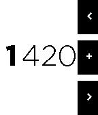

<!-- Generated by scripts/update_app_directory.py: do not edit by hand -->
[← All Pebble Developers](../developers.md)

# iAbadia

*2 apps · Last updated 2026-10-12 · [About these lists](../about-app-lists.md)*

Links: [Pebble App Store](https://apps.repebble.com/apps/dev/iabadia_54837f4e0748a15484000144) · [GitHub (iAbadia)](https://github.com/iAbadia) · [Website (iabadia.github.io)](http://iabadia.github.io/Pebble-Public-Transport-Zgz/)

<button type="button" data-filter="all" aria-pressed="true">All 2</button><button type="button" data-filter="watchface" aria-pressed="false" disabled>Watchfaces 0</button><button type="button" data-filter="watchapp" aria-pressed="false">Apps 2</button>

<label class="dev-sort">Sort by <select><option value="updated">Recently updated</option><option value="released">Newest release</option><option value="title">A–Z</option></select></label>

<h2 class="app-name" id="app-5689657664bdb8bfb800001d"><a href="https://apps.repebble.com/5689657664bdb8bfb800001d">Zaragoza Public Transport</a> v1.2</h2>
<a class="app-source" href="https://github.com/iAbadia/Pebble-Public-Transport-Zgz" title="Source code" data-search-exclude>View source</a>

App

MIT Released 2016-01-03 Updated 2016-02-03

Runs on: Time 2, Pebble 2 Duo, Pebble 2, Time, Classic

Pebble app for Zaragoza tram and bus times How to use: For tram times, select between the full list of stops or choose one from your recent searches. For bus times, choose from recent searches or…

<h2 class="app-name" id="app-56acbb21778c299ff9000025"><a href="https://apps.repebble.com/56acbb21778c299ff9000025">4 Digit numeric keyboard demo</a> v1.0</h2>
<a class="app-source" href="https://github.com/iAbadia/Pebble-4-Digit-Num-Keyboard" title="Source code" data-search-exclude>View source</a>

App

MIT Released 2016-01-30 Updated 2016-01-30

Runs on: Time 2, Pebble 2 Duo, Pebble 2, Time, Classic

Numeric Keyboard demo, pebble.js source available at my GitHub: iAbadia

