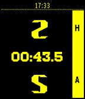

<!-- Generated by scripts/update_app_directory.py: do not edit by hand -->
[← All Pebble Developers](../developers.md)

# Ian Donnelly

*1 app · Last updated 2026-10-11 · [About these lists](../about-app-lists.md)*

Links: [Pebble App Store](https://apps.repebble.com/apps/dev/ian-donnelly_52f049ddbb34231cf300115a) · [GitHub (iandonnelly)](https://github.com/iandonnelly)

<h2 class="app-name" id="app-5596fdf684bff56157000094"><a href="https://apps.repebble.com/5596fdf684bff56157000094">SportsOfficial</a> v1.2</h2>
<a class="app-source" href="https://github.com/iandonnelly/SportsOfficial" title="Source code" data-search-exclude>View source</a>

App

Released 2015-07-03 Updated 2015-11-08

Runs on: Time 2, Pebble 2 Duo, Pebble 2, Time, Classic

SportsOfficial is a scorekeeping app which allows users to keep track of score and time for nearly any sport! The app includes stopwatch functionality to keep track of the time of a sporting…

