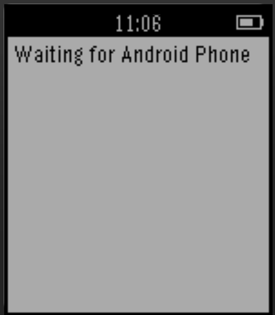

<!-- Generated by scripts/update_app_directory.py: do not edit by hand -->
[← All Pebble Developers](../developers.md)

# IbrahimAnsari

*1 app · Last updated 2026-10-12 · [About these lists](../about-app-lists.md)*

Links: [Pebble App Store](https://apps.repebble.com/apps/dev/ibrahimansari_53137898bb31cff552000340) · [GitHub (ibrahimansari)](https://github.com/ibrahimansari) · [Website (iansari.com)](http://iansari.com/Slapp/)

<h2 class="app-name" id="app-552179d9d7356c3f40000048"><a href="https://apps.repebble.com/552179d9d7356c3f40000048">Slapp</a> v1.0</h2>
<a class="app-source" href="https://github.com/ibrahimansari/Slapp-Pebble-Client" title="Source code" data-search-exclude>View source</a>

App

No licence Released 2015-04-05 Updated 2015-04-05

Runs on: Time 2, Pebble 2 Duo, Pebble 2, Time, Classic

A revolutionary way to meet new people and immediately connect with them. We can exchange your contact and other social networking information with a customizble gesture on your wearble device…

