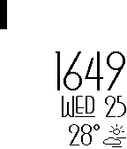
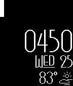

<!-- Generated by scripts/update_app_directory.py: do not edit by hand -->
[← All Pebble Developers](../developers.md)

# ibrokemy.computer

*2 watchfaces · Last updated 2026-10-12 · [About these lists](../about-app-lists.md)*

Links: [Pebble App Store](https://apps.repebble.com/apps/dev/ibrokemy-computer_5456d42334f53e473b000007) · [GitHub (ibrokemycomputer)](https://github.com/ibrokemycomputer)

<button type="button" data-filter="all" aria-pressed="true">All 2</button><button type="button" data-filter="watchface" aria-pressed="false">Watchfaces 2</button><button type="button" data-filter="watchapp" aria-pressed="false" disabled>Apps 0</button>

<label class="dev-sort">Sort by <select><option value="updated">Recently updated</option><option value="released">Newest release</option><option value="title">A–Z</option></select></label>

<h2 class="app-name" id="app-574661d496f915e89f000020"><a href="https://apps.repebble.com/574661d496f915e89f000020">Wunder Weather: Donate</a> v1.2</h2>
<a class="app-source" href="https://github.com/ibrokemycomputer/wunderweather" title="Source code" data-search-exclude>View source</a>

Watchface

GPL-3.0 Released 2016-05-26 Updated 2025-11-25

Runs on: Time 2, Pebble 2 Duo, Pebble 2, Time, Classic

***FREE for the first 10 people to install it. Simply use the discount code &quot;TRYITOUT&quot; at checkout. Please let me know if you have any problems with using the new KiezelPay feature.*** This is the…

<h2 class="app-name" id="app-57464e56e8666d30f5000022"><a href="https://apps.repebble.com/57464e56e8666d30f5000022">Wunder Weather</a> v1.2</h2>
<a class="app-source" href="https://github.com/ibrokemycomputer/wunderweather" title="Source code" data-search-exclude>View source</a>

Watchface

GPL-3.0 Released 2016-05-26 Updated 2025-11-25

Runs on: Time 2, Pebble 2 Duo, Pebble 2, Time, Classic

This is the free version of Wunder Weather. Features a minimal vertical battery meter, Wunderground weather (I find it to be more accurate than OpenWeather) with PDC icons, time and date. Settings…

