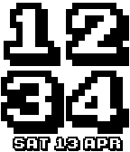

<!-- Generated by scripts/update_app_directory.py: do not edit by hand -->
[← All Pebble Developers](../developers.md)

# Ice2097

*2 watchfaces · Last updated 2026-10-12 · [About these lists](../about-app-lists.md)*

Links: [Pebble App Store](https://apps.repebble.com/apps/dev/ice2097_52f060be61b75250fb0016d1) · [GitHub (ice2097)](https://github.com/ice2097)

<button type="button" data-filter="all" aria-pressed="true">All 2</button><button type="button" data-filter="watchface" aria-pressed="false">Watchfaces 2</button><button type="button" data-filter="watchapp" aria-pressed="false" disabled>Apps 0</button>

<label class="dev-sort">Sort by <select><option value="updated">Recently updated</option><option value="released">Newest release</option><option value="title">A–Z</option></select></label>

<h2 class="app-name" id="app-52f07bb23fbdbae612000961"><a href="https://apps.repebble.com/52f07bb23fbdbae612000961">Pix</a> v2.0.0</h2>
<a class="app-source" href="https://github.com/ice2097/Pix2" title="Source code" data-search-exclude>View source</a>

Watchface

No licence Released 2014-02-04 Updated 2014-02-04

Runs on: Time 2, Pebble 2 Duo, Pebble 2, Time, Classic

Clean and easy to read. Has month, day and day of the week at the bottom in a matching font.

<h2 class="app-name" id="app-52f072e93fbdba5287001a81"><a href="https://apps.repebble.com/52f072e93fbdba5287001a81">Arcade Time</a> v2.0.0</h2>
<a class="app-source" href="https://github.com/ice2097/Arcade_Time" title="Source code" data-search-exclude>View source</a>

Watchface

No licence Released 2014-02-04 Updated 2014-02-04

Runs on: Time 2, Pebble 2 Duo, Pebble 2, Time, Classic

A BigTime variant, with a classic arcade score font, and the day, month, and date at the bottom.

