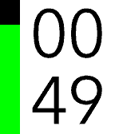
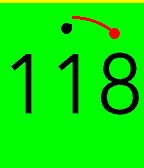
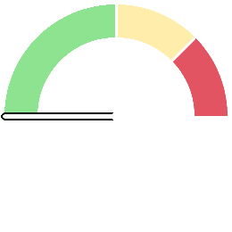
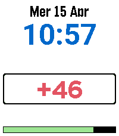

<!-- Generated by scripts/update_app_directory.py: do not edit by hand -->
[← All Pebble Developers](../developers.md)

# iginoc

*2 watchfaces and 3 apps · Last updated 2026-10-12 · [About these lists](../about-app-lists.md)*

Links: [Pebble App Store](https://apps.repebble.com/apps/dev/iginoc_b831c2f23c283d5eb0ca1134) · [GitHub (iginoc)](https://github.com/iginoc)

<button type="button" data-filter="all" aria-pressed="true">All 5</button><button type="button" data-filter="watchface" aria-pressed="false">Watchfaces 2</button><button type="button" data-filter="watchapp" aria-pressed="false">Apps 3</button>

<label class="dev-sort">Sort by <select><option value="updated">Recently updated</option><option value="released">Newest release</option><option value="title">A–Z</option></select></label>

<h2 class="app-name" id="app-bb5bc885bd1f4d469571a699"><a href="https://apps.repebble.com/bb5bc885bd1f4d469571a699">igitimer</a> v1.4.0</h2>
<a class="app-source" href="https://github.com/iginoc/igitimer" title="Source code" data-search-exclude>View source</a>

App

No licence Released 2026-01-17 Updated 2026-05-31

Runs on: Round 2, Time 2, Pebble 2 Duo, Pebble 2, Time Round, Time, Classic

A simple and functional timer for Pebble smartwatches, featuring a high-contrast interface and quick controls. Button Functions UP Button Single Press: Adds 1 minute to the timer. Long Press: Adds…

<h2 class="app-name" id="app-df73341019fd4b5fa0f30f17"><a href="https://apps.repebble.com/df73341019fd4b5fa0f30f17">igitimer-graphic-big</a> v1.6</h2>
<a class="app-source" href="https://github.com/iginoc/igitimer-graphic-big" title="Source code" data-search-exclude>View source</a>

App

No licence Released 2026-01-27 Updated 2026-05-27

Runs on: Round 2, Time 2, Pebble 2 Duo, Pebble 2, Time Round, Time, Classic

Timer with nice animations

<h2 class="app-name" id="app-008e01e6880644b0abc2abe9"><a href="https://apps.repebble.com/008e01e6880644b0abc2abe9">igi-Assistant</a> v1.4.1</h2>
<a class="app-source" href="https://github.com/iginoc/igi-assistant" title="Source code" data-search-exclude>View source</a>

App

No licence Released 2026-03-22 Updated 2026-04-22

Runs on: Round 2, Time 2, Pebble 2 Duo, Pebble 2, Time Round, Time, Classic

A comprehensive control interface for Home Assistant on your Pebble smartwatch. Monitor sensors, control lights, manage music, and chat with your home, all from your wrist with a high-contrast…

<h2 class="app-name" id="app-6b5789aa944d4ae8b0d391e1"><a href="https://apps.repebble.com/6b5789aa944d4ae8b0d391e1">igi-anniversary</a> v1.3</h2>
<a class="app-source" href="https://github.com/iginoc/pebble-orologio" title="Source code" data-search-exclude>View source</a>

Watchface

No licence Released 2026-04-15 Updated 2026-04-16

Runs on: Round 2, Time 2, Pebble 2 Duo, Pebble 2, Time Round, Time, Classic

A custom watchface for Pebble watches featuring a configurable countdown to specific events, date in Italian, and night mode. Features Digital Clock: Clear time display (supports 12h/24h formats)…

<h2 class="app-name" id="app-541e8a0bf9834be6a17e6c19"><a href="https://apps.repebble.com/541e8a0bf9834be6a17e6c19">igiwatch</a> v2.0</h2>
<a class="app-source" href="https://github.com/iginoc/igiwatch" title="Source code" data-search-exclude>View source</a>

Watchface

No licence Released 2026-03-07 Updated 2026-03-08

Runs on: Round 2, Time 2, Pebble 2 Duo, Pebble 2, Time Round, Time, Classic

A dynamic and minimalist watchface for Pebble smartwatches that adapts to your viewing angle using the accelerometer. Features Smart Orientation: The time display rotates to remain readable…

