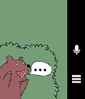
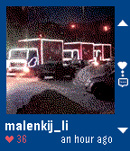

<!-- Generated by scripts/update_app_directory.py: do not edit by hand -->
[← All Pebble Developers](../developers.md)

# Igor Zalomskij

*2 apps · Last updated 2026-10-11 · [About these lists](../about-app-lists.md)*

Links: [Rebble App Store](https://apps.rebble.io/en_US/developer/583c663200355a4bea00030d/1) · [GitHub (kaist)](https://github.com/kaist) · [Website (4pda.ru)](http://4pda.ru/forum/index.php?showtopic=818099)

<button type="button" data-filter="all" aria-pressed="true">All 2</button><button type="button" data-filter="watchface" aria-pressed="false" disabled>Watchfaces 0</button><button type="button" data-filter="watchapp" aria-pressed="false">Apps 2</button>

<label class="dev-sort">Sort by <select><option value="updated">Recently updated</option><option value="released">Newest release</option><option value="title">A–Z</option></select></label>

<h2 class="app-name" id="app-58ec86dd6ca3872acd0005d2"><a href="https://apps.rebble.io/en_US/application/58ec86dd6ca3872acd0005d2">Шепот</a> v1.2-rbl1</h2>
<a class="app-source" href="https://github.com/kaist/shepot" title="Source code" data-search-exclude>View source</a>

App

Released 2017-04-11 Updated 2019-07-24 Rebble App Store

Runs on: Round 2, Time 2, Time Round, Time

The application only in Russian language! Делайте заметки и напоминания голосом на ваших pebble на русском языке. Приложение понимает фразы: Напомни (запомни, джарвис) через час (20 минут, 2 часа)…

<h2 class="app-name" id="app-5859480706e776ae7200039f"><a href="https://apps.rebble.io/en_US/application/5859480706e776ae7200039f">InstAPP</a> v1.2</h2>
<a class="app-source" href="https://github.com/kaist/instapp" title="Source code" data-search-exclude>View source</a>

App

Released 2016-12-20 Updated 2017-08-15 Rebble App Store

Runs on: Round 2, Time 2, Time Round, Time

!!! Its work again!!! InstApp is the app to view instagram timeline on PebbleTime. Attention! The app works with my server. This means that ALL communication goes through a third party site…

