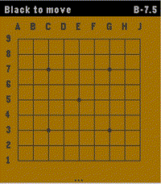

<!-- Generated by scripts/update_app_directory.py: do not edit by hand -->
[← All Pebble Developers](../developers.md)

# igrek51

*1 app · Last updated 2026-10-12 · [About these lists](../about-app-lists.md)*

Links: [Pebble App Store](https://apps.repebble.com/apps/dev/igrek51_04cbe6f6c462ada12b3336f8) · [GitHub (igrek51)](https://github.com/igrek51)

<h2 class="app-name" id="app-35ad80179c4145118edca560"><a href="https://apps.repebble.com/35ad80179c4145118edca560">Game of Go</a> v1.2.0</h2>
<a class="app-source" href="https://github.com/igrek51/pebble-game-of-go" title="Source code" data-search-exclude>View source</a>

App

No licence Released 2026-04-13 Updated 2026-09-19

Runs on: Round 2, Time 2

This app brings the game of Go / Baduk / Weiqi to the Pebble Time 2 with a fast, fully-featured engine and a polished interface. Go is the ultimate mental workout for your commute or coffee break…

