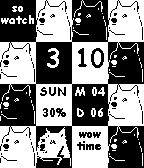

<!-- Generated by scripts/update_app_directory.py: do not edit by hand -->
[← All Pebble Developers](../developers.md)

# iHardtDev

*1 watchface · Last updated 2026-10-11 · [About these lists](../about-app-lists.md)*

Links: [Pebble App Store](https://apps.repebble.com/apps/dev/ihardtdev_530d6aaac3208a834300012c) · [GitHub (tylerl0706)](https://github.com/tylerl0706)

<h2 class="app-name" id="app-5341ae4a57123caf29000411"><a href="https://apps.repebble.com/5341ae4a57123caf29000411">DogeWatch</a> v1.0.2</h2>
<a class="app-source" href="https://github.com/tylerl0706/DogeWatch" title="Source code" data-search-exclude>View source</a>

Watchface

Released 2014-04-06 Updated 2014-04-12

Runs on: Time 2, Pebble 2 Duo, Pebble 2, Time, Classic

Wow. Such watch. Very time. Displays: Time, Day of the Week, Date, battery level and a whole lot of Doge!

