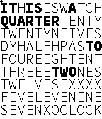
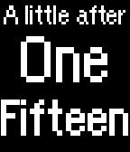

<!-- Generated by scripts/update_app_directory.py: do not edit by hand -->
[← All Pebble Developers](../developers.md)

# ihtnc

*4 watchfaces · Last updated 2026-10-12 · [About these lists](../about-app-lists.md)*

Links: [Pebble App Store](https://apps.repebble.com/apps/dev/ihtnc_529a3cd3e627ce820a000106) · [GitHub (ihtnc)](https://github.com/ihtnc)

<button type="button" data-filter="all" aria-pressed="true">All 4</button><button type="button" data-filter="watchface" aria-pressed="false">Watchfaces 4</button><button type="button" data-filter="watchapp" aria-pressed="false" disabled>Apps 0</button>

<label class="dev-sort">Sort by <select><option value="updated">Recently updated</option><option value="released">Newest release</option><option value="title">A–Z</option></select></label>

<h2 class="app-name" id="app-52e08596fae0b79fd3000061"><a href="https://apps.repebble.com/52e08596fae0b79fd3000061">Smart Square (PH)</a> v1.0</h2>
<a class="app-source" href="https://github.com/ihtnc/Pebble-SmartSquare/tree/ph_PH" title="Source code" data-search-exclude>View source</a>

Watchface

MIT Released 2014-01-23 Updated 2025-12-01

Runs on: Time 2, Pebble 2 Duo, Pebble 2, Time, Classic

A modified WordSquare watch face (by Hudson and Jnmattern) to support tap gestures for displaying basic info. Bluetooth = &quot;X&quot; at the bottom of the screen if disconnected Battery level = Squares on…

<h2 class="app-name" id="app-52d6fdba333d76f2f5000019"><a href="https://apps.repebble.com/52d6fdba333d76f2f5000019">Smart Square</a> v1.0</h2>
<a class="app-source" href="https://github.com/ihtnc/Pebble-SmartSquare" title="Source code" data-search-exclude>View source</a>

Watchface

MIT Released 2014-01-15 Updated 2025-12-01

Runs on: Time 2, Pebble 2 Duo, Pebble 2, Time, Classic

A modified WordSquare watch face (by Hudson and Jnmattern) to support tap gestures for displaying basic info. Bluetooth = &quot;X&quot; at the bottom of the screen if disconnected Battery level = Squares on…

<h2 class="app-name" id="app-529a3ff3e627ce021a00010c"><a href="https://apps.repebble.com/529a3ff3e627ce021a00010c">Orange Kid</a> v2.0</h2>
<a class="app-source" href="https://github.com/ihtnc/Pebble-OrangeKid" title="Source code" data-search-exclude>View source</a>

Watchface

MIT Released 2013-11-30 Updated 2025-12-01

Runs on: Time 2, Pebble 2 Duo, Pebble 2, Time, Classic

A modified A Conversation with Orange Kid watch face (by Ice2097) to support animations. Some settings are configurable via the Pebble phone app.

<h2 class="app-name" id="app-52a8bf5bc7faf7590f00000a"><a href="https://apps.repebble.com/52a8bf5bc7faf7590f00000a">Filipino Time</a> v2.0</h2>
<a class="app-source" href="https://github.com/ihtnc/Pebble-FilipinoTime" title="Source code" data-search-exclude>View source</a>

Watchface

No licence Released 2013-12-11 Updated 2025-12-01

Runs on: Time 2, Pebble 2 Duo, Pebble 2, Time, Classic

A text watch face for the Philippine&#x27;s national language -- Filipino. Some settings are configurable via the Pebble phone app.

