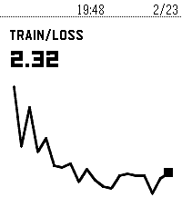
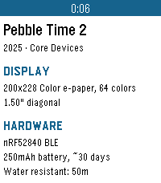
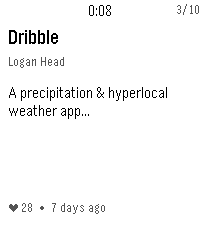

<!-- Generated by scripts/update_app_directory.py: do not edit by hand -->
[← All Pebble Developers](../developers.md)

# Ilia Breitburg

*1 watchface and 5 apps · Last updated 2026-10-11 · [About these lists](../about-app-lists.md)*

Links: [Pebble App Store](https://apps.repebble.com/apps/dev/ilia-breitburg_5bf5720a24bed3000188e5cd) · [Rebble App Store](https://apps.rebble.io/en_US/developer/5bf5720a24bed3000188e5cd/1) · [GitHub (breitburg)](https://github.com/breitburg) · [GitHub (flipcards)](https://github.com/flipcards) · [Website (breitburg.com)](https://breitburg.com/)

<button type="button" data-filter="all" aria-pressed="true">All 6</button><button type="button" data-filter="watchface" aria-pressed="false">Watchfaces 1</button><button type="button" data-filter="watchapp" aria-pressed="false">Apps 5</button>

<label class="dev-sort">Sort by <select><option value="updated">Recently updated</option><option value="released">Newest release</option><option value="title">A–Z</option></select></label>

<h2 class="app-name" id="app-695542edce101c00098adc05"><a href="https://apps.repebble.com/695542edce101c00098adc05">Wrist &amp; Biases</a> v1.6</h2>
<a class="app-source" href="https://github.com/breitburg/wrist-and-biases" title="Source code" data-search-exclude>View source</a>

App · <a href="https://forum.rebble.io/t/403" title="Discuss this app on the Rebble forum" data-search-exclude>Forum thread</a>

No licence Released 2025-12-31 Updated 2026-02-09

Runs on: Round 2, Time 2, Pebble 2 Duo, Pebble 2, Time Round, Time

Monitor your Weights &amp; Biases ML training runs from your Pebble smartwatch.

<h2 class="app-name" id="app-695fca487697aa0009be2375"><a href="https://apps.repebble.com/695fca487697aa0009be2375">Pebbletracker</a> v1.0</h2>
<a class="app-source" href="https://github.com/breitburg/pebbletracker" title="Source code" data-search-exclude>View source</a>

App · <a href="https://forum.rebble.io/t/457" title="Discuss this app on the Rebble forum" data-search-exclude>Forum thread</a>

No licence Released 2026-01-08 Updated 2026-01-08

Runs on: Round 2, Time 2, Pebble 2 Duo, Pebble 2, Time Round, Time, Classic

Pebbletracker provides detailed information on every Pebble smartwatch ever made, including items such as processor speed, memory, display type, supported firmware versions, price, storage, and…

<h2 class="app-name" id="app-68fe94c3d004720009e0b41a"><a href="https://apps.repebble.com/68fe94c3d004720009e0b41a">Claude</a> v1.14</h2>
<a class="app-source" href="https://github.com/breitburg/claude-for-pebble" title="Source code" data-search-exclude>View source</a>

App · <a href="https://forum.rebble.io/t/323" title="Discuss this app on the Rebble forum" data-search-exclude>Forum thread</a>

Unlicense Released 2025-10-26 Updated 2025-12-20

Runs on: Time 2, Pebble 2 Duo, Pebble 2, Time

Talk to Claude AI directly from your Pebble smartwatch. Use your watch&#x27;s built-in dictation to ask questions and get streaming responses from Claude. Good for quick queries when your phone isn&#x27;t…

<h2 class="app-name" id="app-69065e8ace68bc0009859f49"><a href="https://apps.repebble.com/69065e8ace68bc0009859f49">Flipcards</a> v1.1</h2>
<a class="app-source" href="https://github.com/flipcards" title="Source code" data-search-exclude>View source</a>

App

Released 2025-11-01 Updated 2025-11-03

Runs on: Time 2, Pebble 2 Duo, Pebble 2, Time

Flashcards front-end to access Flipcards server.

<h2 class="app-name" id="app-68fbf93925e7530009b78b10"><a href="https://apps.repebble.com/68fbf93925e7530009b78b10">Storefront</a> v1.2</h2>
<a class="app-source" href="https://github.com/breitburg/pebble-storefront" title="Source code" data-search-exclude>View source</a>

App

No licence Released 2025-10-24 Updated 2025-10-26

Runs on: Time 2, Pebble 2 Duo, Pebble 2, Time

See recently added apps at the Rebble Store.

<h2 class="app-name" id="app-68faada2504cc500097101cf"><a href="https://apps.rebble.io/en_US/application/68faada2504cc500097101cf">DVD</a> v1.0</h2>
<a class="app-source" href="https://github.com/breitburg/pebble-dvd" title="Source code" data-search-exclude>View source</a>

Watchface

No licence Released 2025-10-23 Updated 2025-10-23 Rebble App Store

Runs on: Time 2, Pebble 2 Duo, Pebble 2

A Pebble watchface featuring a bouncing DVD screensaver-style time display with smart power-saving animation.

