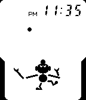

<!-- Generated by scripts/update_app_directory.py: do not edit by hand -->
[← All Pebble Developers](../developers.md)

# Imanolea

*1 watchface · Last updated 2026-10-12 · [About these lists](../about-app-lists.md)*

Links: [Rebble App Store](https://apps.rebble.io/en_US/developer/57fcc2652cde651f0300006a/1) · [GitHub (Imanolea)](https://github.com/Imanolea)

<h2 class="app-name" id="app-5931d6f50dfc326582000cd9"><a href="https://apps.rebble.io/en_US/application/5931d6f50dfc326582000cd9">Game &amp; Watch</a> v1.3</h2>
<a class="app-source" href="https://github.com/Imanolea/watchface_gameandwatch" title="Source code" data-search-exclude>View source</a>

Watchface

MIT Released 2017-06-02 Updated 2017-06-02 Rebble App Store

Runs on: Round 2, Time 2, Pebble 2 Duo, Pebble 2, Time Round, Time, Classic

A watchface that pays homage to the Game &amp; Watch series videogame Ball.

