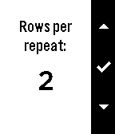

<!-- Generated by scripts/update_app_directory.py: do not edit by hand -->
[← All Pebble Developers](../developers.md)

# Indika Informatics

*1 app · Last updated 2026-10-12 · [About these lists](../about-app-lists.md)*

Links: [Pebble App Store](https://apps.repebble.com/apps/dev/indika-informatics_535ab9beb980d6051000001e) · [GitHub (kaveet)](https://github.com/kaveet)

<h2 class="app-name" id="app-56e3a8485d0b2e499d000037"><a href="https://apps.repebble.com/56e3a8485d0b2e499d000037">Knibble</a> v1.4</h2>
<a class="app-source" href="https://github.com/kaveet/knibble" title="Source code" data-search-exclude>View source</a>

App

Released 2016-03-12 Updated 2016-03-20

Runs on: Time 2, Pebble 2 Duo, Pebble 2, Time, Classic

NiftyKnit is reborn as Knibble! Keep track of your knitting row and repeat counts from the convenience of your wrist. Knibble even remembers where you left off--the counters are always saved to…

