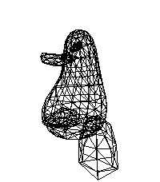

<!-- Generated by scripts/update_app_directory.py: do not edit by hand -->
[← All Pebble Developers](../developers.md)

# innokentiy\_t

*1 watchface and 1 app · Last updated 2026-10-12 · [About these lists](../about-app-lists.md)*

Links: [Pebble App Store](https://apps.repebble.com/apps/dev/innokentiy-t_68f9c18dd3c6e4000885b8cb) · [GitHub (innokentiyt)](https://github.com/innokentiyt)

<button type="button" data-filter="all" aria-pressed="true">All 2</button><button type="button" data-filter="watchface" aria-pressed="false">Watchfaces 1</button><button type="button" data-filter="watchapp" aria-pressed="false">Apps 1</button>

<label class="dev-sort">Sort by <select><option value="updated">Recently updated</option><option value="released">Newest release</option><option value="title">A–Z</option></select></label>

<h2 class="app-name" id="app-6958f4e091ea9d0009ebd756"><a href="https://apps.repebble.com/6958f4e091ea9d0009ebd756">Penger 3D</a> v1.0</h2>
<a class="app-source" href="https://github.com/innokentiyt/formula-pebble" title="Source code" data-search-exclude>View source</a>

App · <a href="https://forum.rebble.io/t/425" title="Discuss this app on the Rebble forum" data-search-exclude>Forum thread</a>

MIT Released 2026-01-03 Updated 2026-01-03

Runs on: Round 2, Time 2, Pebble 2 Duo, Pebble 2, Time Round, Time, Classic

It&#x27;s just a simple demo app based on Tsoding&#x27;s &quot;One Formula That Demystifies 3D Graphics&quot; YouTube video for simple perspective-correct 3D rendering using wireframes and one really simple math…

<h2 class="app-name" id="app-690c15d63e734c0009b9df2a"><a href="https://apps.repebble.com/690c15d63e734c0009b9df2a">Hellboy</a> v1.2</h2>
<a class="app-source" href="https://github.com/innokentiyt/wf-hellboy" title="Source code" data-search-exclude>View source</a>

Watchface

MIT Released 2025-11-06 Updated 2025-11-17

Runs on: Time 2, Pebble 2 Duo, Pebble 2, Time, Classic

A simple watchface for Pebble. Insipred by an illustration from &quot;Hellboy: The Lost Army&quot; novel. Features: - battery meter is a bottom thin line under ⚡ on HB&#x27;s right shoulder; - bt connection…

