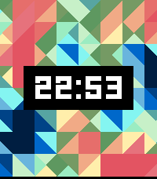

<!-- Generated by scripts/update_app_directory.py: do not edit by hand -->
[← All Pebble Developers](../developers.md)

# Intrinseca

*1 watchface · Last updated 2026-10-11 · [About these lists](../about-app-lists.md)*

Links: [Rebble App Store](https://apps.rebble.io/en_US/developer/5663f3ccf7c6e0dd41000006/1) · [GitLab (intrinseca)](https://gitlab.com/intrinseca)

<h2 class="app-name" id="app-6a4eca251eb8590009825e40"><a href="https://apps.rebble.io/en_US/application/6a4eca251eb8590009825e40">Perlin Grid</a> v1.0.0</h2>
<a class="app-source" href="https://gitlab.com/intrinseca/perlin-grid" title="Source code" data-search-exclude>View source</a>

Watchface · <a href="https://forum.rebble.io/t/1134" title="Discuss this app on the Rebble forum" data-search-exclude>Forum thread</a>

Released 2026-07-08 Updated 2026-07-08 Rebble App Store

Runs on: Time 2

Inspired by Triangles and Perlin, uses Perlin Noise to generate a random grid of colourful triangles as the watchface background.

