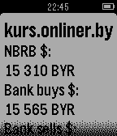

<!-- Generated by scripts/update_app_directory.py: do not edit by hand -->
[← All Pebble Developers](../developers.md)

# introkun

*1 app · Last updated 2026-10-11 · [About these lists](../about-app-lists.md)*

Links: [Pebble App Store](https://apps.repebble.com/apps/dev/introkun_52f2a1f20da945e49c00007d) · [GitHub (introkun)](https://github.com/introkun)

<h2 class="app-name" id="app-54c93a4bbcb00065d300004b"><a href="https://apps.repebble.com/54c93a4bbcb00065d300004b">kurs.onliner.by</a> v1.1</h2>
<a class="app-source" href="http://github.com/introkun/PebbleCurrencyMinsk" title="Source code" data-search-exclude>View source</a>

App

No licence Released 2015-01-28 Updated 2015-01-28

Runs on: Time 2, Pebble 2 Duo, Pebble 2, Time, Classic

Most recent currency exchange rates in Minsk, Belarus

