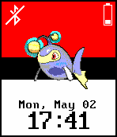

<!-- Generated by scripts/update_app_directory.py: do not edit by hand -->
[← All Pebble Developers](../developers.md)

# invitedsun

*1 watchface · Last updated 2026-10-11 · [About these lists](../about-app-lists.md)*

Links: [Pebble App Store](https://apps.repebble.com/apps/dev/invitedsun_570af466235d5ac80f000006) · [GitHub (a-spo)](https://github.com/a-spo)

<h2 class="app-name" id="app-5723a8c7801d31f15900000c"><a href="https://apps.repebble.com/5723a8c7801d31f15900000c">Animated Pokemon Face</a> v1.0</h2>
<a class="app-source" href="https://github.com/a-spo/AnimatedDex.git" title="Source code" data-search-exclude>View source</a>

Watchface

No licence Released 2016-04-29 Updated 2016-05-02

Runs on: Round 2, Time 2, Time Round, Time

This watchface features Gen 6 sprites! Included in this version are Mega Asbol, Lanturn, Azumarill, and Luxray. Shake to animate each sprite for 10 seconds. With the release of sun and moon, gen 7…

