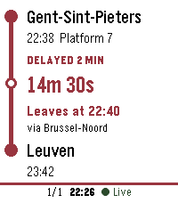

<!-- Generated by scripts/update_app_directory.py: do not edit by hand -->
[← All Pebble Developers](../developers.md)

# iRail

*1 app · Last updated 2026-11-23 · [About these lists](../about-app-lists.md)*

Links: [Pebble App Store](https://apps.repebble.com/apps/dev/irail_02b967b0677e996505fe62a6) · [GitHub (irail)](https://github.com/irail)

<h2 class="app-name" id="app-96eb4caf9fc34a199723fd07"><a href="https://apps.repebble.com/96eb4caf9fc34a199723fd07">Traindown Belgium</a> v1.4.0</h2>
<a class="app-source" href="https://github.com/irail/traindown-pebble" title="Source code" data-search-exclude>View source</a>

App

No licence Released 2026-11-11 Updated 2026-11-15

Runs on: Round 2, Time 2, Pebble 2 Duo, Time Round

Real-time Journey Planner for NMBS/SNCB that counts down until your train leaves

